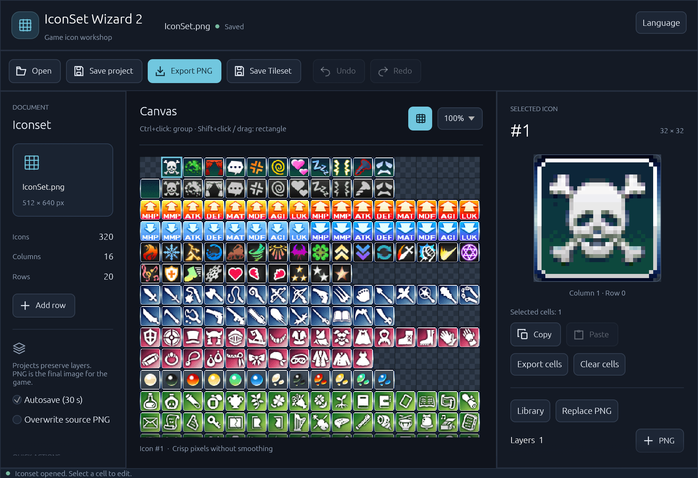

# IconSet Wizard 2

A free, open-source desktop editor for game icon sets. Combine images into layered icons, adjust their appearance, and export a PNG atlas ready for your game.

IconSet Wizard 2 works with 32 × 32 icons arranged in a 16-column atlas. It is useful for assembling item, skill, equipment, and interface icons without editing every variation by hand.

**[Download & installation](#download--installation)** · **[Build from source](#build-from-source)** · **[MIT license](LICENSE)**

## Screenshot



## Features

- **Layered icons:** import PNG images, combine them in a cell, duplicate layers, and rearrange their order.
- **Live adjustments:** move, rotate, scale, flip, recolor, and change the opacity of layers with an immediate preview. Keep crisp pixels or enable smoothing.
- **Batch editing:** select groups of icons, copy, cut, paste, or clear them. Copying groups preserves their arrangement and works between application windows.
- **Icon library:** browse the included `.iwpk` packages, search by package name, description, or icon number, and bookmark favorites.
- **Flexible export:** export the full atlas or save selected icons as individual PNG files.
- **Editable projects:** save layers and adjustments in `.isw2` projects and return to them later.
- **Undo and recovery:** undo or redo edits, use automatic saving, and recover work after an unexpected shutdown.
- **Three interface languages:** English, Russian, and Simplified Chinese, switchable from the Language menu.

## Download & Installation

1. Open this repository's **[Releases](../../releases)** page.
2. Download the latest release archive for your platform, when available. Choose the application archive from **Assets**, rather than GitHub's automatically generated source archives.
3. Extract the entire archive to a folder of your choice.
4. On Windows, run **`IconSetWizard2.exe`**. No installer, Rust toolchain, or .NET runtime is required.

Release archives include a **`packages`** folder with the icon library. Keep it next to the executable so the application can find it automatically. You can also choose another library folder from within the application.

Windows is the current distribution platform. Linux and macOS builds and application packaging have not yet been verified; see [Build from source](#build-from-source) if you want to try building for your system.

## Quick Start

1. Click **Open** and choose a PNG icon atlas, or open an existing `.isw2` project.
2. Select an icon on the canvas. Use the zoom control and enlarged preview to inspect it.
3. Add a PNG layer or choose an icon from the **Library**. You can also drag PNG files onto the window to add layers to the selected icon.
4. Adjust the layers and click **Apply** to commit your changes. Add rows when you need more space.
5. Click **Save project** to preserve your layers and settings in an `.isw2` file.
6. Click **Export PNG** to create the finished atlas for your game, or **Export cells** to save selected icons individually.

**Projects preserve your work; PNG exports contain the finished image.** Exporting a PNG does not save an editable project. To update the PNG you originally opened, use **Save Tileset**, which asks for confirmation before overwriting it.

When no document is open, dropping a PNG opens it as an atlas. To replace an already open atlas, use **Open**. Dropping an `.isw2` file opens that project.

## Keyboard Shortcuts

| Shortcut | Action |
| --- | --- |
| Ctrl+O | Open an atlas or project |
| Ctrl+S | Save the project |
| Ctrl+Z | Undo |
| Ctrl+Y or Ctrl+Shift+Z | Redo |
| Ctrl+C / Ctrl+X / Ctrl+V | Copy / cut / paste selected icons |
| Ctrl+A | Select all icons |
| Delete | Clear selected cells |
| Ctrl+click | Add or remove a cell from the selection |
| Shift+click | Select a rectangular area |
| Drag across cells | Select an area |
| Ctrl+drag | Add an area to the selection |

On macOS, use **Command** instead of Ctrl. When a text field is active, editing shortcuts apply to that field.

## Supported Formats & Limitations

| Format | Purpose |
| --- | --- |
| `.png` | Open or export icon atlases; import layer images; export individual icons |
| `.isw2` | Save and reopen editable projects with layers and adjustments |
| `.iwpk` | Load icon packages from the original IconSet Wizard |

- Atlases use **32 × 32 cells**, **16 columns**, and a **512 px width**, with up to **256 rows**.
- Imported layer images are resized to fit a 32 × 32 cell.
- This is an icon composition editor; pixel painting brushes are not included.
- Extra rows are added manually. A pasted group must fit within the atlas.
- The application needs a graphical desktop and an OpenGL-capable graphics driver.

## Build from Source

Build on the platform you want to run the application on. The instructions below produce a native executable; Linux and macOS support is currently unverified.

### Prerequisites

Install **Git** and the latest stable **Rust** toolchain with Cargo using the [official Rust installation instructions](https://rust-lang.org/tools/install/).

- **Windows:** install Visual Studio Build Tools with the **Desktop development with C++** workload and a Windows SDK. Use Rust's MSVC toolchain.
- **macOS:** install Apple's command-line development tools:

  ```sh
  xcode-select --install
  ```

- **Linux:** install a C/C++ toolchain and the desktop development libraries. For Ubuntu/Debian, a starting point is:

  ```sh
  sudo apt update
  sudo apt install build-essential pkg-config libxcb-render0-dev libxcb-shape0-dev libxcb-xfixes0-dev libxkbcommon-dev libssl-dev libwayland-dev libx11-dev libxi-dev libxrandr-dev libgl1-mesa-dev
  ```

  Package names vary by distribution. File dialogs use XDG Desktop Portal; your desktop session needs a working portal backend, or Zenity as a fallback. See the upstream [eframe Linux requirements](https://github.com/emilk/egui/tree/main/crates/eframe#readme) and [rfd Linux backend documentation](https://github.com/PolyMeilex/rfd#linux--bsd-backends).

### Compile and Run

```sh
git clone https://github.com/KageDesu/IconSetWizard2.git IconSetWizard2
cd IconSetWizard2
cargo build --release --locked
```

The executable is created here:

| Platform | Output |
| --- | --- |
| Windows | `target/release/iconset-wizard.exe` |
| Linux / macOS | `target/release/iconset-wizard` |

Run it on Windows (PowerShell):

```powershell
.\target\release\iconset-wizard.exe
```

Run it on Linux or macOS:

```sh
./target/release/iconset-wizard
```

To build and launch directly through Cargo:

```sh
cargo run --release --locked
```

The source checkout does not include the bundled icon packages. To use the release library with your own build, extract `packages` from a release archive and place it beside the executable, or select that folder in the application's Library window.

## Feedback & Contributions

Bug reports, feature suggestions, and pull requests are welcome through this repository's **Issues** and **Pull requests** tabs. For a bug report, include your operating system, application version, and steps to reproduce the problem.

## License & Credits

Created by **Phoenix KageDesu** — [KD Workshop](https://kdworkshop.net/).

IconSet Wizard 2 is open source and licensed under the **[MIT License](LICENSE)**.

The embedded **Noto Sans CJK SC** font is licensed under the **SIL Open Font License 1.1**; see [the font license](assets/fonts/LICENSE). Release distributions include it as `NotoSansCJK-LICENSE.txt`.

The MIT license covers the application source code. Bundled icon artwork and third-party packages remain subject to their respective authors' licenses and usage terms.
